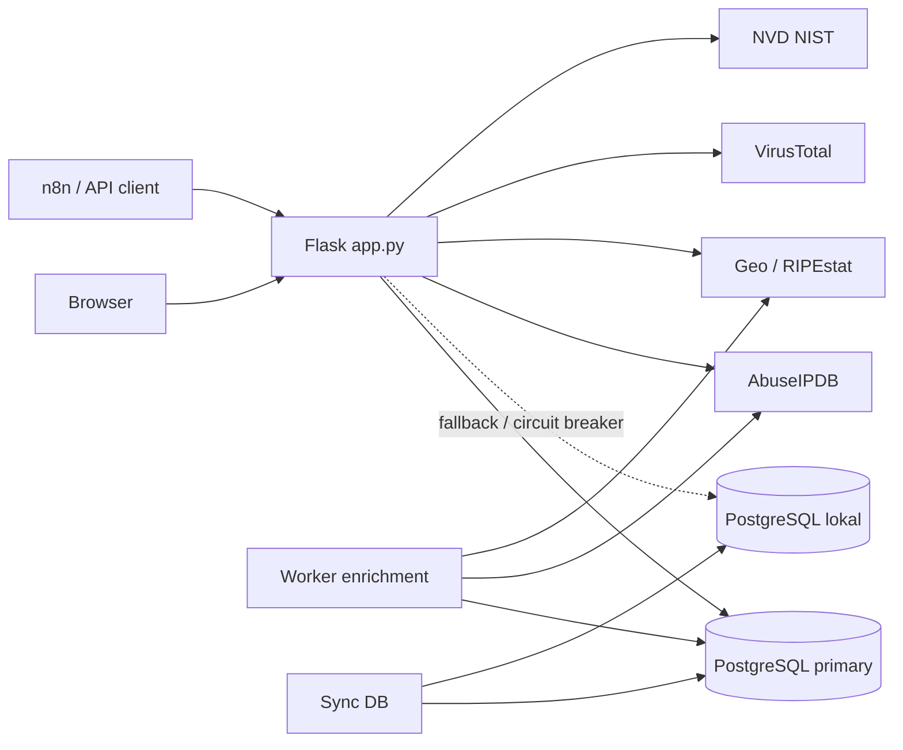
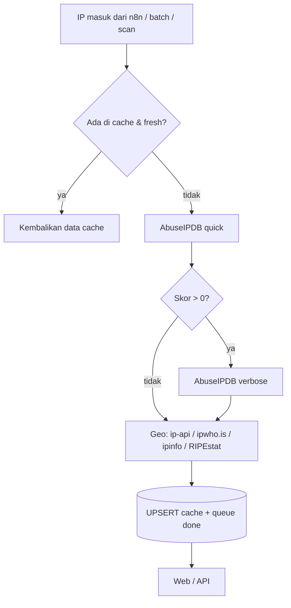
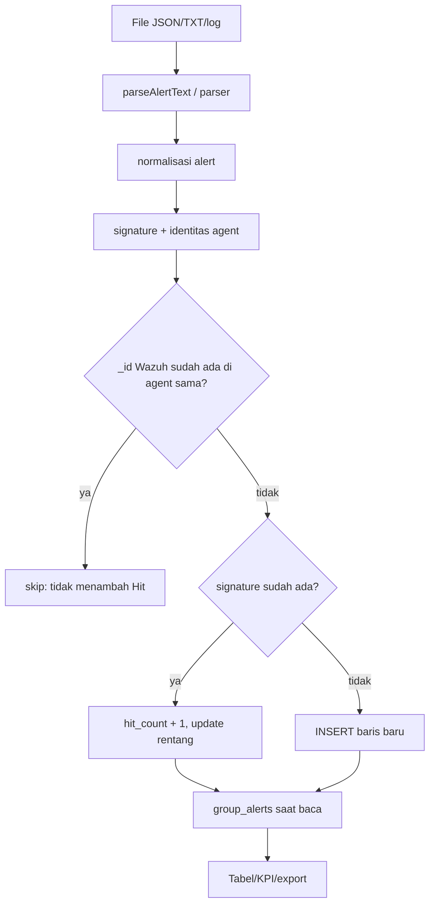

# IPIntel — CyberSOC & Threat Intelligence Web

Aplikasi web Flask untuk membaca, menggabungkan, mencari, dan mengekspor log Wazuh;
mengelola IOC/event MISP; serta menjalankan enrichment IP dan file hash. Database utama
adalah PostgreSQL. UI memakai satu shell **Watchfloor** (sidebar, tema terang/gelap,
tipografi dan komponen yang konsisten) untuk semua halaman.

Peta kode yang dihasilkan Graphify ada di:

- [`graphify-out/graph.html`](graphify-out/graph.html) — viewer interaktif
- [`graphify-out/GRAPH_REPORT.md`](graphify-out/GRAPH_REPORT.md) — ringkasan graph
- [`graphify-out/graph.json`](graphify-out/graph.json) — data GraphRAG
- [`docs/STRUCTURE.md`](docs/STRUCTURE.md) — tree + route map versi mini-graphify

---

## 1. Ringkasan fungsi

| Kelompok | Fungsi |
|---|---|
| IP Intelligence | Cache reputasi IP, skor AbuseIPDB, geo/ASN, riwayat event, scan batch, antrean worker |
| SOC Log Reader | Impor alert Wazuh/Elasticsearch, normalisasi log, dedup signature, Hit, rentang waktu, filter host/tanggal, export XLSX/DOCX |
| MISP / CTI | Event, atribut/IOC, korelasi, sightings, threat actor, detection rule, threat feed |
| Tools | CVE lookup NVD, HTTP status reference, MITRE ATT&CK, hash + cache VirusTotal, defang/refang, triage multi-IOC |
| Integrasi | REST API, sidecar n8n, export STIX 2.1/MISP/Suricata/Snort/CSV/blocklist |
| Operasional | Status worker, sinkron DB remote ↔ lokal, health check, API docs |

---

## 2. Arsitektur



Prinsip utama:

1. **DB-first** — data yang sudah ada dan masih segar dipakai ulang; API eksternal hanya
   dipanggil jika data belum ada atau sudah basi.
2. **Remote-first dengan fallback** — `db.get_conn()` mencoba PostgreSQL primer, lalu
   otomatis memakai PostgreSQL lokal bila primer tidak terjangkau.
3. **Satu sumber tampilan** — `templates/base.html` menyediakan sidebar, tema, tombol,
   kartu, tabel, modal, dan aturan responsif untuk seluruh halaman.
4. **Impor bersifat menambah** — data lama tidak dihapus otomatis. Penghapusan harus
   eksplisit lewat API/aksi UI.

---

## 3. Struktur folder

| Path | Isi |
|---|---|
| `app.py` | Aplikasi Flask, seluruh route halaman/API, query DB, import/export SOC |
| `soc_parser.py` | Parser log, normalisasi signature, grouping, `Hit`, time range, field tampilan/export |
| `db.py` | Koneksi PostgreSQL primer/lokal, circuit breaker, status DB, schema queue |
| `config.py` | Konfigurasi DB dan API key (bisa dioverride environment variable) |
| `worker.py` | Worker background enrichment dan sync threat feed |
| `scan.py` | CLI scan IP dan pemanggilan AbuseIPDB/geo |
| `sidecar.py` | API cache/enrichment untuk n8n (IP dan file hash) |
| `misp.py` | Event/atribut MISP, korelasi, feed, export, rule generation, triage |
| `knowledge.py` | Knowledge base HTTP status, MITRE, negara, lookup NVD |
| `sync_db.py` | Sinkron tabel remote ↔ lokal |
| `refresh_windows.py` | Refresh data report window |
| `templates/` | 24 template halaman, semuanya extends `base.html` |
| `schema.sql` | Skema PostgreSQL inti (IP, MISP, feed, aktor, rule, Wazuh alerts) |
| `graphify_project.py` | Generator graph mini ke `docs/` |
| `test_soc_parser.py` | Regression test parser/grouping SOC (tanpa Flask/DB) |
| `graphify-out/` | Output Graphify (HTML, JSON, report) |

---

## 4. Menjalankan aplikasi

### 4.1 Lewat Docker (cara yang dipakai sekarang)

Service: `homestack-ipintel-1`. URL lokal:

```text
http://127.0.0.1:8898
```

Di production web dilayani di bawah prefix `/intel/`.

Perintah operasional:

```bash
# lihat status
docker ps --filter name=homestack-ipintel-1

# restart setelah mengubah template/app.py
docker restart homestack-ipintel-1

# cek log
docker logs -f homestack-ipintel-1
```

### 4.2 Langsung dengan Python

```bash
cd /home/hetshi/work/ipintel
python3 -m py_compile app.py
python3 app.py
```

Dependensi yang dipakai antara lain Flask, psycopg2, requests, openpyxl,
python-docx, dan redis (opsional untuk cache/rate limit).

### 4.3 Health check

```http
GET /api/health
```

Respons normal: `{"ok": true}`.

---

## 5. Halaman web, bagian demi bagian

Semua halaman memakai sidebar yang sama. Sidebar bisa ditutup dan dibuka kembali;
statusnya disimpan di `localStorage` dengan key `ipintel-nav-collapsed`.

### 5.1 Dashboard IP — `GET /`

Halaman utama cache IP.

- Tabel IP dengan search (IP, ISP, ASN, kota, negara, domain).
- Filter skor minimum dan versi IP (`all`, `4`, `6`).
- Sort berdasarkan skor atau jumlah hit.
- Pagination 50 baris.
- KPI: total cache, IP berisiko, skor tertinggi, data basi > 7 hari, antrean.
- Tombol scan/update IP basi.
- Status threat feed otomatis.

### 5.2 Detail IP — `GET /ip/<ip>`

- Profil IP dari cache: skor, negara, ISP/ASN, geo, domain, hostname, Tor/whitelist.
- Raw JSON AbuseIPDB dan geo.
- Riwayat `ip_intel_events` (jenis serangan, subtype, MITRE, target, endpoint, outcome).
- Log Wazuh terbaru untuk IP tersebut (method, URL, status, full log, rule).
- Placeholder tetap dibuat bila IP hanya muncul di log Wazuh dan belum ada di cache.

### 5.3 Batch Search — `GET/POST /batch`, `POST /batch/scan`

- Paste/upload CSV atau daftar IP berantakan (termasuk `IP,count`, `a OR b`, port).
- Parsing IP v4/v6, dedup, laporan baris invalid/CIDR/port.
- Pencocokan ke cache dan penandaan IP yang belum ada.
- Salin hasil ke format `data.srcip: ("a" OR "b")` untuk SIEM.
- Scan cepat/lengkap dan progress per tahap.

### 5.4 Events Log — `GET /events`

- Daftar `ip_intel_events`: IP, waktu, tipe alert, subtype, MITRE, target host,
  endpoint, outcome, ringkasan.
- Filter search, tipe alert, dan subtype.
- Agregasi endpoint teratas.
- Pagination 100 baris.

### 5.5 Antrean — `GET /queue`

- Status worker (queued/doing/done/fail), heartbeat worker.
- Daftar antrean enrichment dan error terakhir.
- Filter status dan search IP.
- Pagination 100 baris.

### 5.6 Statistik — `GET /stats`

- Distribusi skor AbuseIPDB (0%, 1–24%, 25–74%, 75–100%).
- Negara teratas, jenis serangan, MITRE, endpoint, subtype.
- Total cache, total event, data basi.

### 5.7 CVE NIST — `GET /cve`, `GET /api/cve`

- Lookup CVE berdasarkan ID atau keyword.
- Sumber: NVD API.
- Hasil ditampilkan sebagai kartu/tabel; error API ditampilkan tanpa mematikan halaman.

### 5.8 HTTP Status — `GET /http-status`, `GET /api/http-status`

- Referensi status HTTP 1xx–5xx: arti, kelas, dan rekomendasi tindakan SOC.
- Search berdasarkan kode/nama/arti.

### 5.9 File Hash — `GET/POST /hash`, `POST /api/hash`

- Hash MD5, SHA1, SHA256, SHA512 dari teks atau upload file.
- Batas upload 10 MB.
- Cek cache lokal `public.file_hashes` sebelum memanggil VirusTotal.
- Batas kuota VT per request dan cache agar hash sama tidak memakai kuota dua kali.
- Status cache/error ditampilkan di halaman.

### 5.10 MITRE ATT&CK — `GET /mitre`

- Taktik/teknik dari data cache dan event.
- Referensi taktik dari `knowledge.py`.
- Agregasi subtype serangan.

### 5.11 MISP Events — `GET /misp`

- Daftar event MISP: judul, threat level, TLP, aktor, malware, campaign, tanggal,
  jumlah atribut.
- Filter search, threat level, TLP.
- Pagination 20 event.

### 5.12 Detail Event MISP — `GET /misp/event/<id>`

- Metadata event, deskripsi, tag, aktor, malware.
- Daftar atribut/IOC.
- Form tambah atribut dan catat sightings.
- Tautan korelasi IOC.

### 5.13 Import MISP — `GET/POST /misp/import`

- Upload file JSON MISP atau tempel payload JSON.
- Impor event + atribut; setelah berhasil diarahkan ke event pertama.

### 5.14 Universal IoCs — `GET /iocs`

- Semua atribut MISP dalam satu registry.
- Filter search, tipe IOC, `to_ids`.
- Pagination 50 baris.

### 5.15 Korelasi IOC — `GET /correlate?val=...`

- Mencari satu nilai IOC di event MISP, cache IP, event terbaru, dan threat actor.
- Dipakai untuk pivot cepat dari IoC ke konteks.

### 5.16 Threat Feeds — `GET /threat-feeds`

- Daftar feed, status sync terakhir, jumlah item, log sync.
- Tombol sync manual per feed.
- Worker juga dapat melakukan sync otomatis.

### 5.17 Threat Actors / APT — `GET /actors`

- Knowledge base aktor: alias, negara, motivasi, target sektor, malware,
  teknik MITRE, tahun aktif, deskripsi.

### 5.18 Detection Rules — `GET /rules`

- Aturan YARA/Sigma: nama, tipe, severity, deskripsi, isi rule, author, tag.

### 5.19 IoC Defanger — `GET/POST /tools/defang`, `POST /tools/refang`

- Defang/refang URL, domain, IP, email, hash.
- Berguna sebelum mengirim IOC ke tiket/chat agar tidak clickable.

### 5.20 Cyber Triage — `GET/POST /triage`

- Tempel banyak observables (IP, domain, URL, hash, email).
- Deteksi tipe IOC otomatis.
- Pencocokan dengan data MISP/cache dan ringkasan verdict.

### 5.21 Sinkron DB — `GET /sync`, `POST /api/sync/start`, `GET /api/sync/status`

- Menampilkan status DB remote dan lokal: reachable, latency, jumlah baris.
- Sinkron pull (remote → lokal) atau push (lokal → remote).
- Status job dan riwayat sync terakhir.

### 5.22 API & Integrasi — `GET /api/docs`

- Dokumentasi endpoint, contoh payload, dan petunjuk integrasi n8n.
- Menampilkan status DB aktif (Remote/Lokal).

### 5.23 SOC Log Reader — `GET /soc-logs`

Halaman inti untuk alert Wazuh. Detailnya ada di bagian 6.

---

## 6. SOC Log Reader — bagian demi bagian

### 6.1 Sumber data dan tampilan

- Sumber: `public.wazuh_alerts`.
- Halaman **selalu memuat seluruh grup** pada filter aktif; tidak ada lagi batas
  tampilan 500.
- KPI: jumlah grup, total Hit, grup berulang, IP sumber, level maksimum,
  status HTTP, tenant/agent.
- Tab: tabel breakdown, kartu, dan laporan analisis Markdown.

### 6.2 Filter

- **Host** — filter eksak `agent_name` (fallback ke `raw_json.agent.name`,
  `tenant`, dan label tenant). Pilihan “Semua host” mengembalikan semua host.
- **Tanggal** — 7/30/60 hari, rentang kustom, atau “Semua” (`days=all`).
  Default 60 hari.
- **Search** — full log, source IP, URL, dan deskripsi rule.
- **Filter cepat** — semua, 4xx, 5xx, metode, dan kriteria lain di UI.
- **Sort** — waktu, Hit, sumber, level, dan kolom lain; source IP diurutkan
  numerik untuk IPv4, lalu IPv6/hostname/kosong.

### 6.3 Impor

Format yang didukung:

- JSON Wazuh / Elasticsearch (`hits.hits[]`, `alerts[]`, array biasa, objek tunggal).
- NDJSON / JSON per baris.
- File `.json`, `.txt`, `.log`, `.ndjson`.
- Baris log mentah (access log, syslog, AppArmor, dll.).
- Paste teks/JSON di modal.

Perilaku penting:

1. **Impor menambah**, bukan mengganti. Database tidak dikosongkan otomatis.
2. **Agent context** — untuk log mentah yang tidak punya metadata agent, UI memakai:
   - isian **Agent / sumber log** bila diisi; atau
   - nama file (tanpa ekstensi) bila isian kosong.
3. JSON Wazuh yang sudah memiliki `agent.name`/`agent.id` **tidak** ditimpa oleh
   isian manual. Identitas asli Wazuh yang dipakai.
4. Export tetap **masked**; raw `log.json` tidak disediakan.
5. File `.zip` harus diekstrak dulu.

### 6.4 Signature dan dedup

Signature stabil dibentuk dari:

```text
rule.id + tenant + agent_identity + source IP + hostname + normalized(full_log)
```

`agent_identity` memprioritaskan `agent.id`; bila tidak ada, memakai kombinasi
`agent.name`, `agent.ip`, dan `agent.hostname`. Ini mencegah dua agent berbeda
yang namanya kebetulan sama dianggap satu baris.

Normalisasi membuang metadata volatil:

- timestamp di header/pesan;
- serial `audit(...)`;
- `pid=...`;
- uptime kernel `[2955743.701286]`;
- header hostname syslog (identitas agent tetap disimpan terpisah).

Konsekuensi:

- Isi log yang identik dari **agent yang sama** digabung; `Hit` bertambah.
- Isi log yang identik dari **agent berbeda** tetap menjadi grup terpisah.
- `_id` Wazuh yang sama pada agent yang sama tidak menambah `Hit`.
- `_id` Wazuh yang sama tetapi agent berbeda tetap boleh masuk sebagai baris
  terpisah.
- Signature lama tetap dapat digabung saat pembacaan: `enrich_alert()` menghitung
  ulang signature dari isi + identitas agent. Ini menjaga kompatibilitas baris
  lama tanpa harus menulis ulang seluruh tabel.
- Baris lama yang **sudah telanjur tergabung** sebelum perbaikan tidak lagi
  menyimpan identitas agent asli. Bila ditemukan grup lama yang tercampur,
  hapus grup tersebut lalu impor ulang lognya.

### 6.5 Hit, waktu, dan tampilan log

- `Hit` = jumlah kemunculan dengan signature sama.
- `first_seen`/`last_seen` = rentang waktu kemunculan.
- Format rentang: `12.10.20 s/d 13.00.20` (hari sama) atau
  `21/10 12.10.20 s/d 22/10 13.00.20`.
- Log non-HTTP tidak pernah dipaksa menjadi `GET`, `200`, atau path `"21"`.
- Detail full log dapat dibuka lewat modal; JSON mentah tetap menyimpan field asli,
  termasuk field compliance bila ada.

### 6.6 Hapus data

- Hapus satu grup: `POST /api/soc-logs/delete` dengan `id` atau `ids`.
- Hapus seluruh tabel: `POST /api/soc-logs/clear` (aksi eksplisit).
- Grup hasil penggabungan menyimpan `_group_row_ids`; penghapusan grup akan
  menghapus semua baris DB yang termasuk grup tersebut.

### 6.7 Export

- XLSX dan DOCX dari data yang sedang tampil (setelah filter/sort).
- Kolom PCI-DSS, NIST 800-53, dan TSC tidak ditampilkan/diexport.
- XLSX memakai A4 landscape, fit-to-width, wrapping, dan tinggi baris adaptif.
- DOCX memakai A4 landscape (`297×210 mm`), margin 8 mm, tabel 270 mm.
- Raw JSON tetap lengkap; hanya tampilan/export yang dibersihkan.

### 6.8 API SOC

| Method | Endpoint | Fungsi |
|---|---|---|
| GET | `/api/soc-logs` | Ambil grup; default semua; `limit` opsional untuk integrasi |
| POST | `/api/soc-logs` | Impor alert (JSON/array/NDJSON/raw lines) |
| POST | `/api/soc-logs/delete` | Hapus grup berdasarkan `id`/`ids` |
| POST | `/api/soc-logs/clear` | Kosongkan tabel |
| GET/POST | `/api/soc-logs/export/xlsx` | Download XLSX |
| GET/POST | `/api/soc-logs/export/docx` | Download DOCX |

Parameter GET yang penting: `days`, `day`, `from`, `to`, `host`, `q`, `limit`.

---

## 7. Alur data

### 7.1 Enrichment IP



### 7.2 Impor SOC



### 7.3 MISP / CTI

- Event MISP disimpan di `misp_events`; atribut di `misp_attributes`.
- Korelasi mencocokkan nilai IOC dengan atribut, cache IP, event, dan aktor.
- Export: MISP JSON, STIX 2.1, CSV, blocklist teks, Suricata, Snort.
- Sighting dicatat di `ioc_sightings`.

---

## 8. Daftar route

### 8.1 Halaman

| Method | Path | Fungsi |
|---|---|---|
| GET | `/` | Dashboard IP |
| GET | `/ip/<path:ip>` | Detail IP |
| GET/POST | `/batch` | Batch search |
| POST | `/batch/scan` | Scan batch |
| GET | `/events` | Events log |
| GET | `/queue` | Antrean enrichment |
| GET | `/stats` | Statistik |
| GET | `/cve` | CVE NIST |
| GET | `/http-status` | HTTP status |
| GET/POST | `/hash` | File hash |
| GET | `/mitre` | MITRE ATT&CK |
| GET | `/sync` | Sinkron DB |
| GET | `/misp` | MISP events |
| GET | `/misp/event/<int:event_id>` | Detail event MISP |
| POST | `/misp/event/new` | Buat event MISP baru |
| POST | `/misp/event/<int:event_id>/add-attribute` | Tambah atribut ke event |
| GET/POST | `/misp/import` | Import MISP JSON |
| GET/POST | `/threat-feeds/sync/<feed_id>` | Sync manual satu feed |
| GET | `/iocs` | Universal IoCs |
| GET | `/correlate` | Korelasi IOC |
| GET | `/threat-feeds` | Threat feeds |
| GET | `/actors` | Threat actors |
| GET | `/rules` | Detection rules |
| GET/POST | `/tools/defang` | Defang |
| POST | `/tools/refang` | Refang |
| GET/POST | `/triage` | Triage multi-IOC |
| GET | `/api/docs` | Dokumentasi API |
| GET | `/soc-logs` | SOC Log Reader |

### 8.2 API utama

| Method | Path | Fungsi |
|---|---|---|
| GET | `/api/health` | Health check |
| GET | `/api/queue` | Status antrean |
| POST | `/api/update` | Antrekan update skor basi |
| POST | `/api/enrich` | Enrichment IP DB-first |
| GET | `/api/threat-feeds` | Status feed |
| GET | `/api/cve` | Lookup NVD |
| GET | `/api/http-status` | Referensi HTTP |
| POST | `/api/hash` | Hash input |
| POST | `/api/sync/start` | Mulai sinkron DB |
| GET | `/api/sync/status` | Status sinkron |
| GET/POST | `/ip-intel` | Sidecar IP untuk n8n |
| GET/POST | `/file-intel` | Sidecar hash untuk n8n |
| GET | `/api/misp/export` | Export MISP JSON |
| GET | `/api/stix2/export` | Export STIX 2.1 |
| GET | `/api/export/ip.txt` | Blocklist IP |
| GET | `/api/export/domains.txt` | Blocklist domain |
| GET | `/api/export/urls.txt` | Blocklist URL |
| GET | `/api/export/hashes.txt` | Blocklist hash |
| GET | `/api/export/csv` | Export CSV IOC |
| GET | `/api/export/suricata.rules` | Rule Suricata |
| GET | `/api/export/snort.rules` | Rule Snort |
| POST | `/api/sightings/add` | Catat sighting |

---

## 9. Database

### 9.1 Tabel inti

| Tabel | Fungsi |
|---|---|
| `ip_intel_cache` | Cache reputasi/geo IP (tabel remote utama) |
| `ip_intel_events` | Event serangan yang terkait IP |
| `ip_enrichment` | Skema cache IP versi lama/lokal |
| `enrich_queue` | Antrean worker enrichment |
| `file_hashes` | Cache hash dan hasil VirusTotal |
| `cve_cache` | Cache hasil NVD (opsional) |

### 9.2 Tabel CTI

| Tabel | Fungsi |
|---|---|
| `misp_events` | Event MISP |
| `misp_attributes` | Atribut/IOC |
| `ioc_sightings` | Riwayat sighting |
| `threat_feeds` | Daftar feed |
| `feed_sync_logs` | Log sync feed |
| `threat_actors` | Knowledge base APT/aktor |
| `detection_rules` | Rule YARA/Sigma |

### 9.3 Tabel SOC

`public.wazuh_alerts` menyimpan satu baris per signature/agent:

| Kolom | Keterangan |
|---|---|
| `_id` | Primary key; signature (`sig_...`) atau ID lama |
| `timestamp` | Waktu alert terbaru |
| `tenant` | Tenant/agent label |
| `agent_name`, `agent_ip` | Identitas agent untuk tampilan/filter |
| `rule_id`, `rule_level`, `rule_desc` | Rule Wazuh |
| `srcip`, `method`, `url`, `status_code` | Field HTTP/non-HTTP yang aman |
| `full_log` | Log asli |
| `raw_json` | Payload asli Wazuh |
| `log_signature` | Signature grup |
| `hit_count` | Jumlah kemunculan |
| `wazuh_ids` | Daftar `_id` Wazuh asli |
| `first_seen`, `last_seen` | Rentang waktu |

Index penting: `srcip`, `agent_name`, `tenant`, `status_code`, `rule_level`,
`timestamp`, `log_signature`, dan GIN pada `wazuh_ids`.

---

## 10. Parser SOC dan aturan keamanan tampilan

- Parser tidak mengasumsikan semua log adalah HTTP.
- Access log dideteksi lewat pola Apache/Nginx; syslog/AppArmor/sshd diparse sebagai
  teks terstruktur.
- Field yang tidak ada tidak diisi dengan nilai karangan.
- Status HTTP hanya diambil dari field yang valid 3 digit pada log HTTP.
- Detail/export SOC tidak menampilkan PCI-DSS, NIST 800-53, atau TSC.
- Raw JSON tetap menyimpan data asli untuk audit.

Regression test:

```bash
python3 test_soc_parser.py
```

Saat ini mencakup 20 test: parsing access log, AppArmor, sshd, JSON, normalisasi
timestamp/PID, dedup signature, Hit/rentang, identitas agent, raw log dengan agent
berbeda, kompatibilitas signature lama, dan field non-HTTP.

---

## 11. Konfigurasi dan keamanan

Konfigurasi DB dan API key dapat dioverride environment variable:

| Variable | Fungsi |
|---|---|
| `PG_HOST`, `PG_PORT`, `PG_DB`, `PG_USER`, `PG_PASSWORD` | PostgreSQL primer |
| `PG_PROBE_TIMEOUT` | Timeout probe primer sebelum fallback |
| `LOCAL_PG_HOST`, `LOCAL_PG_PORT`, `LOCAL_PG_DB`, `LOCAL_PG_USER`, `LOCAL_PG_PASSWORD` | PostgreSQL lokal |
| `ABUSE_KEY` | API key AbuseIPDB |
| `VT_KEY` | API key VirusTotal |
| `IPINTEL_API_KEY` | Kunci opsional header `X-API-Key` untuk sidecar |

Catatan:

- Jangan menaruh kredensial asli di dokumen, tiket, atau commit publik.
- `config.py` memiliki nilai default; untuk deployment baru sebaiknya gunakan env
  dan rotasi key.
- Endpoint sidecar hanya memeriksa `X-API-Key` bila `IPINTEL_API_KEY` diisi.
- Upload hash dibatasi 10 MB.
- Export SOC selalu masked.

---

## 12. Graphify dan dokumentasi struktur

Graphify dijalankan pada source code dan README:

```bash
graphify extract /home/hetshi/work/ipintel --code-only
graphify update /home/hetshi/work/ipintel
graphify cluster-only /home/hetshi/work/ipintel --no-label
```

Output:

- `graphify-out/graph.html`
- `graphify-out/graph.json`
- `graphify-out/GRAPH_REPORT.md`

Mini-graphify lama (tree, mermaid, route map) dapat diregenerasi dengan:

```bash
python3 graphify_project.py
# output: docs/STRUCTURE.md, docs/graph.html, docs/graph.json
```

Graphify saat ini menemukan **532 node, 1.108 edge, 19 community**. Node pusatnya
antara lain `get_conn()`, `nav_counts()`, `parse_log_line()`,
`ensure_wazuh_alerts_schema()`, `api_soc_logs()`, dan `build_log_signature()`.

---

## 13. Troubleshooting

| Gejala | Penyebab umum | Solusi |
|---|---|---|
| Halaman SOC hanya menampilkan sebagian data | URL lama masih membawa `limit`, atau API client memakai `limit` | Halaman UI sekarang mengabaikan limit; API tanpa `limit` mengembalikan semua |
| Log dari agent berbeda dianggap duplikat | File log mentah tidak membawa metadata agent | Isi kolom **Agent / sumber log**, atau beri nama file sesuai agent; JSON Wazuh memakai `agent.id` asli |
| Import bilang duplikat | `_id` Wazuh sama pada agent yang sama, atau signature sama | Ini by design; cek agent dan `_id` |
| Database terlihat beda setelah restart | Koneksi berpindah remote ↔ lokal | Cek badge Postgres / halaman `/sync` |
| Halaman berat setelah impor besar | Semua grup memang dimuat | Filter host/tanggal, atau arsipkan data lama |
| Export tidak memuat PCI/NIST/TSC | Memang sengaja dihapus dari output | Raw JSON tetap menyimpan field asli |
| Worker tidak jalan | Proses worker/beat mati | Cek `/queue`, restart service |

---

## 14. Catatan operasional

- Setelah mengubah `templates/` atau `app.py`, restart `homestack-ipintel-1`.
- Tabel SOC dimigrasikan secara lazy saat route SOC pertama kali diakses.
- Database lokal dapat dipakai sebagai fallback; data remote dan lokal tidak selalu
  identik. Konfirmasi sisi DB aktif sebelum operasi sensitif.
- Penghapusan data harus eksplisit; tidak ada auto-clear saat impor.
