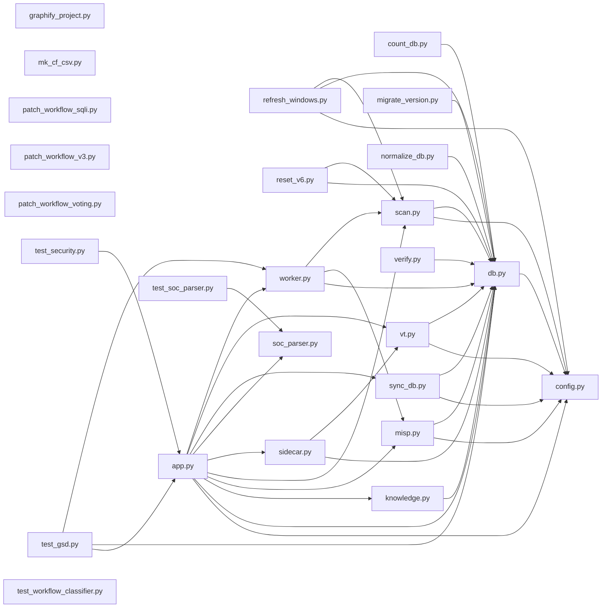
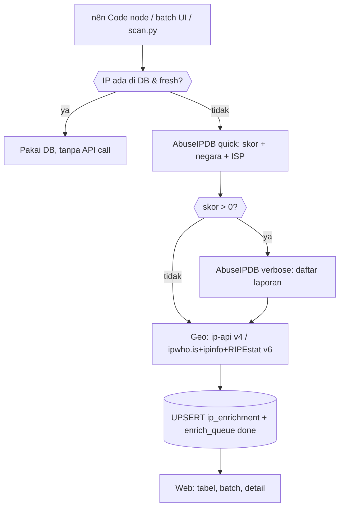

# Struktur Proyek `ipintel/`

> Dibuat otomatis oleh `graphify_project.py`. Jangan edit manual — jalankan ulang script bila kode berubah.

## 1. Tree + ukuran file

```
ipintel/
├─ app.py  (89 KB)
├─ config.py  (1 KB)
├─ count_db.py  (442 B)
├─ db.py  (10 KB)
├─ graphify_project.py  (6 KB)
├─ knowledge.py  (13 KB)
├─ migrate_version.py  (1 KB)
├─ misp.py  (46 KB)
├─ mk_cf_csv.py  (1 KB)
├─ normalize_db.py  (1 KB)
├─ patch_workflow_sqli.py  (7 KB)
├─ patch_workflow_v3.py  (1 KB)
├─ patch_workflow_voting.py  (7 KB)
├─ refresh_windows.py  (11 KB)
├─ reset_v6.py  (1 KB)
├─ scan.py  (12 KB)
├─ sidecar.py  (11 KB)
├─ soc_parser.py  (29 KB)
├─ sync_db.py  (15 KB)
  ├─ api_docs.html  (8 KB)
  ├─ base.html  (39 KB)
  ├─ batch.html  (16 KB)
  ├─ correlate.html  (6 KB)
  ├─ cve.html  (4 KB)
  ├─ detail.html  (9 KB)
  ├─ detection_rules.html  (3 KB)
  ├─ events.html  (4 KB)
  ├─ hash.html  (3 KB)
  ├─ http_status.html  (1 KB)
  ├─ index.html  (14 KB)
  ├─ misp_event_detail.html  (11 KB)
  ├─ misp_events.html  (12 KB)
  ├─ misp_import.html  (2 KB)
  ├─ misp_iocs.html  (7 KB)
  ├─ mitre.html  (5 KB)
  ├─ queue.html  (3 KB)
  ├─ soc_logs.html  (141 KB)
  ├─ stats.html  (4 KB)
  ├─ sync.html  (4 KB)
  ├─ threat_actors.html  (3 KB)
  ├─ threat_feeds.html  (3 KB)
  ├─ tools_defang.html  (3 KB)
  ├─ triage.html  (7 KB)
├─ test_gsd.py  (5 KB)
├─ test_security.py  (1 KB)
├─ test_soc_parser.py  (10 KB)
├─ test_workflow_classifier.py  (2 KB)
├─ verify.py  (674 B)
├─ vt.py  (5 KB)
├─ worker.py  (9 KB)
  ( + __pycache__/ auto-generated, diabaikan)
```

## 2. Graph dependensi modul (siapa import siapa)



## 3. Peta route Flask (`app.py`)

```mermaid
flowchart LR
    subgraph Flask app.py
    index["GET /"]
    detail["GET /ip/<path:ip>"]
    batch["GET,POST /batch"]
    api_health["GET /api/health"]
    api_queue["GET /api/queue"]
    api_threat_feeds["GET /api/threat-feeds"]
    events["GET /events"]
    queue_page["GET /queue"]
    stats["GET /stats"]
    cve_page["GET /cve"]
    api_cve["GET /api/cve"]
    http_status_page["GET /http-status"]
    api_http_status["GET /api/http-status"]
    hash_page["GET,POST /hash"]
    api_hash["POST /api/hash"]
    mitre_page["GET /mitre"]
    sync_page["GET /sync"]
    api_sync_start["POST /api/sync/start"]
    api_sync_status["GET /api/sync/status"]
    sidecar_get_ips["GET /ip-intel"]
    sidecar_post_ip["POST /ip-intel"]
    sidecar_get_hashes["GET /file-intel"]
    sidecar_post_hashes["POST /file-intel"]
    misp_events["GET /misp"]
    misp_event_detail["GET /misp/event/<int:event_id>"]
    misp_import["GET,POST /misp/import"]
    misp_event_new["POST /misp/event/new"]
    misp_add_attribute["POST /misp/event/<int:event_id>/add-attribute"]
    misp_all_iocs["GET /iocs"]
    misp_correlate["GET /correlate"]
    threat_feeds["GET /threat-feeds"]
    threat_feeds_sync["GET,POST /threat-feeds/sync/<feed_id>"]
    threat_actors["GET /actors"]
    detection_rules["GET /rules"]
    tools_defang["GET,POST /tools/defang"]
    tools_refang["POST /tools/refang"]
    api_misp_export["GET /api/misp/export"]
    api_stix2_export["GET /api/stix2/export"]
    api_export_ip_txt["GET /api/export/ip.txt"]
    api_export_domains_txt["GET /api/export/domains.txt"]
    api_export_urls_txt["GET /api/export/urls.txt"]
    api_export_hashes_txt["GET /api/export/hashes.txt"]
    api_export_csv["GET /api/export/csv"]
    triage_page["GET,POST /triage"]
    api_export_suricata["GET /api/export/suricata.rules"]
    api_export_snort["GET /api/export/snort.rules"]
    api_add_sighting["POST /api/sightings/add"]
    api_docs_page["GET /api/docs"]
    soc_logs_page["GET /soc-logs"]
    api_soc_logs["GET,POST /api/soc-logs"]
    api_soc_logs_delete["POST /api/soc-logs/delete"]
    api_soc_logs_clear["POST /api/soc-logs/clear"]
    api_soc_logs_export_xlsx["GET,POST /api/soc-logs/export/xlsx"]
    api_soc_logs_export_docx["GET,POST /api/soc-logs/export/docx"]
    end
    index --> ip_enrichment[(Postgres hetsi.ip_enrichment)]
    batch --> ip_enrichment
    detail --> ip_enrichment
    batch_scan --> ip_enrichment
    api_enrich --> ip_enrichment
    api_enrich --> AbuseIPDB{AbuseIPDB API}
    api_enrich --> Geo{ip-api / ipwho.is / ipinfo / RIPEstat}
```



| Method | Path | Fungsi | Deskripsi |
|---|---|---|---|
| GET | `/` | `index()` | |
| GET | `/ip/<path:ip>` | `detail()` | |
| GET,POST | `/batch` | `batch()` | |
| GET | `/api/health` | `api_health()` | |
| GET | `/api/queue` | `api_queue()` | |
| GET | `/api/threat-feeds` | `api_threat_feeds()` | |
| GET | `/events` | `events()` | |
| GET | `/queue` | `queue_page()` | |
| GET | `/stats` | `stats()` | |
| GET | `/cve` | `cve_page()` | |
| GET | `/api/cve` | `api_cve()` | |
| GET | `/http-status` | `http_status_page()` | |
| GET | `/api/http-status` | `api_http_status()` | |
| GET,POST | `/hash` | `hash_page()` | |
| POST | `/api/hash` | `api_hash()` | |
| GET | `/mitre` | `mitre_page()` | |
| GET | `/sync` | `sync_page()` | |
| POST | `/api/sync/start` | `api_sync_start()` | |
| GET | `/api/sync/status` | `api_sync_status()` | |
| GET | `/ip-intel` | `sidecar_get_ips()` | |
| POST | `/ip-intel` | `sidecar_post_ip()` | |
| GET | `/file-intel` | `sidecar_get_hashes()` | |
| POST | `/file-intel` | `sidecar_post_hashes()` | |
| GET | `/misp` | `misp_events()` | |
| GET | `/misp/event/<int:event_id>` | `misp_event_detail()` | |
| GET,POST | `/misp/import` | `misp_import()` | |
| POST | `/misp/event/new` | `misp_event_new()` | |
| POST | `/misp/event/<int:event_id>/add-attribute` | `misp_add_attribute()` | |
| GET | `/iocs` | `misp_all_iocs()` | |
| GET | `/correlate` | `misp_correlate()` | |
| GET | `/threat-feeds` | `threat_feeds()` | |
| GET,POST | `/threat-feeds/sync/<feed_id>` | `threat_feeds_sync()` | |
| GET | `/actors` | `threat_actors()` | |
| GET | `/rules` | `detection_rules()` | |
| GET,POST | `/tools/defang` | `tools_defang()` | |
| POST | `/tools/refang` | `tools_refang()` | |
| GET | `/api/misp/export` | `api_misp_export()` | |
| GET | `/api/stix2/export` | `api_stix2_export()` | |
| GET | `/api/export/ip.txt` | `api_export_ip_txt()` | |
| GET | `/api/export/domains.txt` | `api_export_domains_txt()` | |
| GET | `/api/export/urls.txt` | `api_export_urls_txt()` | |
| GET | `/api/export/hashes.txt` | `api_export_hashes_txt()` | |
| GET | `/api/export/csv` | `api_export_csv()` | |
| GET,POST | `/triage` | `triage_page()` | |
| GET | `/api/export/suricata.rules` | `api_export_suricata()` | |
| GET | `/api/export/snort.rules` | `api_export_snort()` | |
| POST | `/api/sightings/add` | `api_add_sighting()` | |
| GET | `/api/docs` | `api_docs_page()` | |
| GET | `/soc-logs` | `soc_logs_page()` | |
| GET,POST | `/api/soc-logs` | `api_soc_logs()` | |
| POST | `/api/soc-logs/delete` | `api_soc_logs_delete()` | |
| POST | `/api/soc-logs/clear` | `api_soc_logs_clear()` | |
| GET,POST | `/api/soc-logs/export/xlsx` | `api_soc_logs_export_xlsx()` | |
| GET,POST | `/api/soc-logs/export/docx` | `api_soc_logs_export_docx()` | |

## 4. Alur data enrichment (DB-first)



## 5. Tabel database

```mermaid
erDiagram
    ip_enrichment ||--o{{ enrich_queue : "dilengkapi oleh" }}
    ip_enrichment {{
        TEXT ip PK
        SMALLINT ip_version
        INT abuse_score
        TEXT country_name
        TEXT geo_city
        TEXT geo_asn
        JSONB raw_abuse
        JSONB raw_geo
        TEXT enrich_level
    }}
    enrich_queue {{
        TEXT ip PK
        TEXT status
        INT attempts
        JSONB stage_ms
    }}
```

Lihat `docs/graph.html` untuk viewer interaktif.
