# Arsitektur Arbiter — Web & Tools

> Dokumen ini menjelaskan arsitektur teknis Arbiter: gaya arsitektur, diagram
> konteks dan container, struktur web frontend, struktur tools backend, alur
> data, model data, deployment, keamanan, dan batasan operasional.
>
> Berdasarkan implementasi di repositori: `app/main.py`, `app/static/js/`,
> `app/database.py`, dan modul domain lainnya.

Dokumen terkait:

- [`DOKUMENTASI.md`](DOKUMENTASI.md) — ringkasan, workflow, keamanan, instalasi.
- [`ARCHITECTURE.md`](ARCHITECTURE.md) — kontrak data dan kebijakan klasifikasi.
- [`ui-ux-redesign/DESIGN.md`](ui-ux-redesign/DESIGN.md) — arah desain UI.

---

## 1. Gaya Arsitektur

Arbiter adalah **modular monolith lokal**:

- Satu proses FastAPI melayani API dan aset statis frontend.
- Frontend adalah **vanilla JavaScript ES modules** yang dipecah per fitur,
  bukan SPA framework.
- PostgreSQL adalah satu-satunya penyimpanan persisten.
- Semua pemrosesan berat (parsing, dedup, klasifikasi, korelasi) berjalan
  in-process; tidak ada message broker, worker queue, atau cache eksternal.
- Integrasi keluar bersifat opsional dan eksplisit: Wazuh Indexer, Ollama
  loopback/LAN, database IP Intel, dan AbuseIPDB (hanya saat diminta).

### Prinsip yang membentuk arsitektur

| Prinsip | Konsekuensi teknis |
|---|---|
| Airgapped / local-first | Tidak ada CDN, analytics, telemetri; font dan aset lokal |
| Evidence before verdict | Klasifikasi wajib membawa `signals` + `reason` |
| Deterministic first, AI optional | Rule engine selalu tersedia; Ollama hanya penguat |
| Tenant adalah konteks, bukan otorisasi | Scope melekat pada query dan ekspor |
| Bukti mentah tetap lokal | `full_log` tidak masuk prompt/model payload |
| Degradasi aman | Gagal Wazuh/Ollama/remote DB tidak memblokir workspace lokal |
| Tanpa migrasi framework | HTML/CSS/JS native, tanpa build step frontend |

### Konsekuensi yang disadari

- `app/main.py` bersifat **monolitik** (≈2.500 baris, ±70 endpoint); batas modul
  ditegakkan lewat disiplin impor, bukan framework router.
- Tidak ada ORM; SQL ditulis eksplisit di `main.py`, `query.py`, dan
  `database.py`.
- Frontend merender HTML string dengan `esc()`; tidak ada virtual DOM.
- Switching profil database disimpan di memori proses (plus override
  terenkripsi), sehingga **multi-worker Uvicorn tidak disarankan** untuk fitur
  ini.
- Belum ada job queue; ingest dan ekspor berjalan sinkron dalam request.

---

## 2. Diagram Konteks (C4 Level 1)

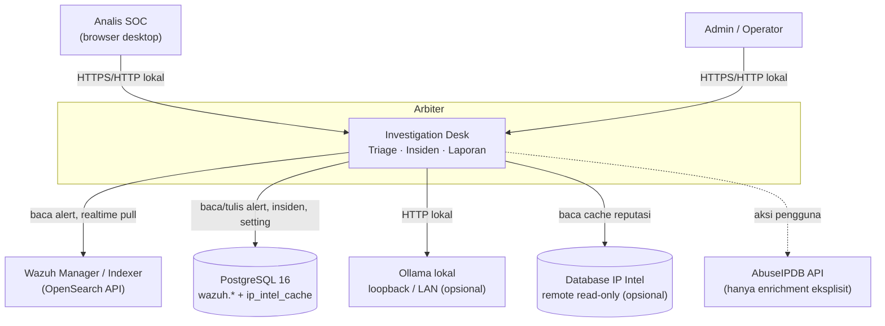

**Aktor:** `analyst` (operasional) dan `admin` (pengguna, database, pengaturan).
**Sistem eksternal:** Wazuh Indexer, PostgreSQL, Ollama, IP Intel, AbuseIPDB.

---

## 3. Diagram Container (C4 Level 2)

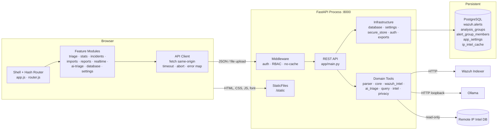

Catatan: server menyajikan `index.html` dan aset; tidak ada server frontend
terpisah dan tidak ada proses build.

---

## 4. Arsitektur Web (Frontend)

### 4.1 Lapisan frontend

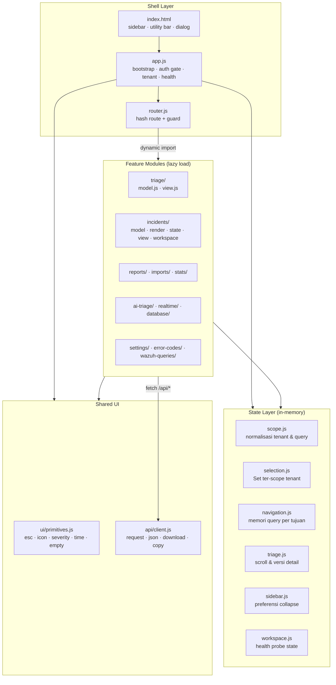

### 4.2 Pola feature module

Setiap destinasi mengikuti kontrak yang sama:

```js
// features/<page>/view.js
export async function mount(context) {
  // context: { root, route, navigate, selection, notify,
  //            databaseChanged, signal, setGuard }
  // render, pasang listener, fetch data
  return function dispose() {
    // lepas listener/timer yang tidak memakai signal
  };
}
```

- `app.js` melakukan `importFeature(page)` → `./features/<page>/view.js`.
- Jika dynamic import gagal karena cache browser, loader mencoba sekali lagi
  dengan query `?retry=<timestamp>`.
- Setiap navigasi membuat `AbortController` baru; request lama dibatalkan.
- `routeVersion` mencegah feature lama menimpa halaman baru.
- `dispose()` dipanggil saat rute berubah atau login gate ditampilkan.
- `setGuard()` mencegah navigasi saat ada perubahan belum disimpan.

Pemisahan `model.js` / `render.js` / `view.js` / `state.js` membuat logika
turunan, markup, dan efek samping dapat diuji terpisah (`tests/frontend/`).

### 4.3 Routing dan scope

- Hash router: `#/<page>?tenant=a&tenant=b&...`.
- Halaman yang dikenali: `triage`, `stats`, `incidents`, `imports`, `reports`,
  `realtime`, `ai-triage`, `wazuh-queries`, `error-codes`, `database`,
  `settings`.
- Tenant di URL adalah sumber kebenaran scope; `scope.js` menormalkan nilai,
  menghapus pagination yang tidak relevan, dan membangun key scope.
- `selection.js` menolak item dari tenant di luar scope aktif.
- `navigation.js` menyimpan query terakhir per destinasi, sehingga pengguna
  kembali ke filter yang sama.

### 4.4 Alur render satu halaman

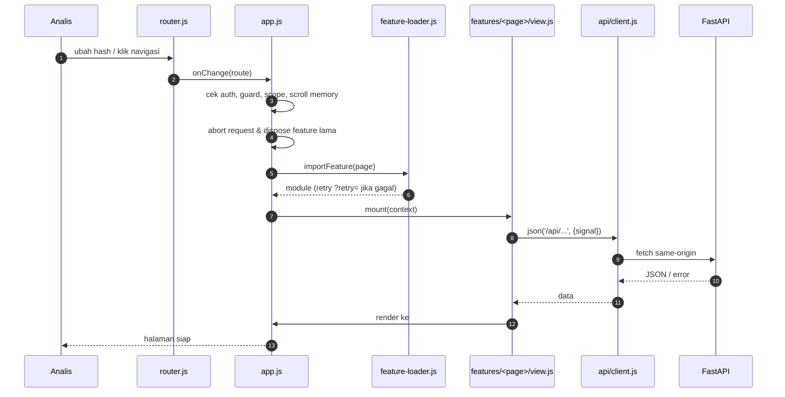

### 4.5 Login gate dan hak tampilan

- `app.js` memanggil `/api/auth/me` pada render pertama.
- Jika tidak terautentikasi, sidebar dan utility bar disembunyikan dan form login
  dirender di area konten.
- Menu `database` dan `settings` disembunyikan untuk role `analyst`.
- Ini hanya lapisan UX; server tetap menolak endpoint admin dengan `403`.

### 4.6 State yang tidak dipersistensi

| State | Lokasi | Hilang saat |
|---|---|---|
| Seleksi alert | Memori `Set` | Reload / ganti tenant |
| Scroll triage | Memori `Map` | Reload |
| Filter per tujuan | Memori `navigation.js` | Reload |
| Preferensi sidebar | `localStorage` | Dibersihkan pengguna |
| Tema | `localStorage` | Dibersihkan pengguna |
| Hasil AI Triage | PostgreSQL (`app_settings`) | Tidak hilang |
| Sesi login | Cookie terenkripsi | 12 jam / logout |

---

## 5. Arsitektur Tools (Backend)

### 5.1 Peta modul dan dependensi

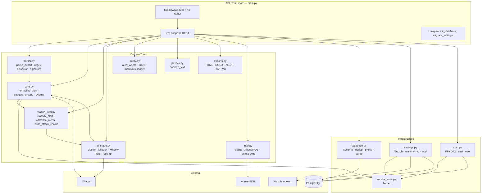

### 5.2 Tanggung jawab per modul

| Modul | Peran arsitektural | Tidak bertanggung jawab atas |
|---|---|---|
| `main.py` | Kontrak HTTP, orkestrasi, validasi input, otorisasi endpoint | Algoritma klasifikasi |
| `parser.py` | Ekstraksi teks/log menjadi struktur | Penentuan verdict |
| `core.py` | Normalisasi alert + signature + grouping dasar | Kebijakan rule kuratif |
| `wazuh_intel.py` | Kebijakan verdict, role, priority, korelasi, chain | Penyimpanan |
| `ai_triage.py` | Clustering, fallback rule, window WIB, sanitasi payload | Memanggil DB langsung |
| `query.py` | SQL filter tenant/time/facet/preset | Menjalankan query |
| `database.py` | Koneksi, skema, dedup upsert, profil, purge | Semantik klasifikasi |
| `settings.py` | Validasi dan penyimpanan konfigurasi Wazuh/AI/intel | Deteksi alert |
| `auth.py` | Kredensial, sesi, role | Otorisasi per-resource |
| `secure_store.py` | Enkripsi/dekripsi lokal | Manajemen kunci terpusat |
| `intel.py` | Reputasi IP dan sinkronisasi cache | Klaim "aman" |
| `privacy.py` | Redaksi deterministik | Jaminan anonimisasi |
| `exports.py` | Format deliverable | Penentuan scope ekspor |

### 5.3 Lapisan request

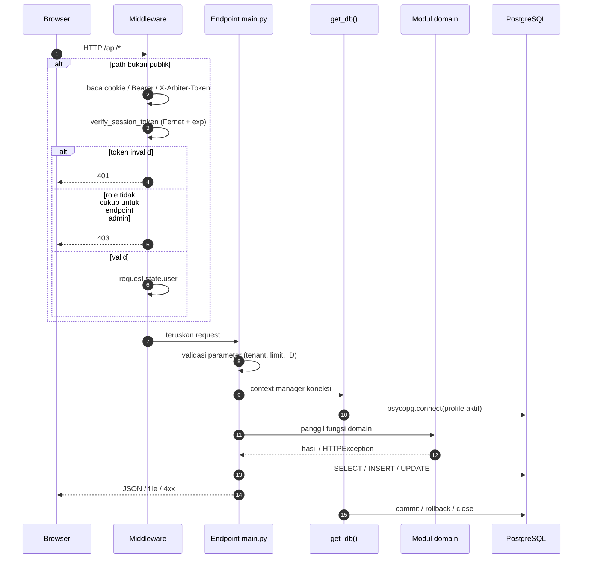

Middleware hanya mengautentikasi jalur `/api/*`. `index.html` dan `/static/*`
tidak memerlukan sesi; data tetap tidak dapat diambil tanpa token API.

### 5.4 Alur ingest end-to-end

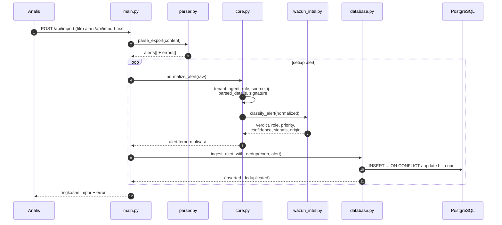

Dedup menggunakan signature stabil; alert berulang menambah `hit_count` dan
memperluas `last_seen`, bukan membuat baris baru.

### 5.5 Alur korelasi dan sugesti

1. `GET /api/suggestions` mengambil alert dalam scope (maksimum 300).
2. `correlate_alerts()` menautkan respons aktif ke origin.
3. Grup kanonik dibentuk dari `(agent_name, rule_id)` → `log_signature` →
   `(source_ip, rule_id)`.
4. `build_attack_chains()` menyusun urutan lintas rule per host+IP.
5. `suggestions_with_fallback()` memakai Ollama hanya jika diaktifkan dan
   tersedia; jika gagal, hasil deterministik tetap dikembalikan.

### 5.6 Alur AI Triage

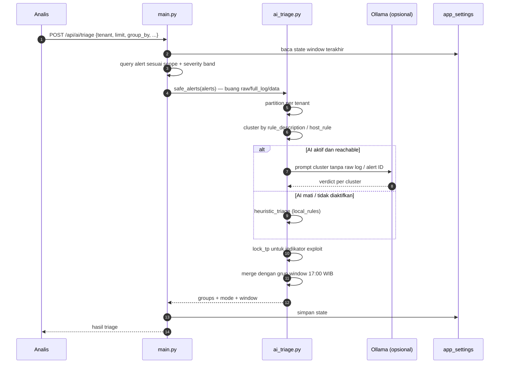

Guardrail penting:

- Satu grup tidak boleh mencampur dua tenant.
- `lock_tp` mengunci true-positive jika ada indikator exploit terverifikasi.
- Model tidak menerima raw log, `data`, `full_log`, atau alert ID.
- Hasil disimpan agar bertahan antar sesi; window harian memakai UTC+7.

### 5.7 Alur ekspor

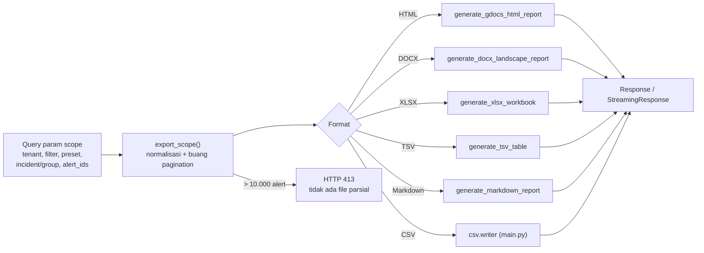

Semua format menerima **filter yang sama**; `scopeParams()` di frontend dan
`export_scope()` di backend menormalkan scope, sehingga preview dan hasil unduhan
konsisten.

### 5.8 Profil database dan pemeliharaan

- Dua profil: `local` (read-write) dan `remote` (read-only).
- Profil aktif adalah variabel proses; override URI remote disimpan terenkripsi
  di `app_settings`.
- `get_db()` selalu memakai profil aktif saat koneksi dibuat.
- Purge alert/insiden:
  1. `dry_run` menghitung jumlah dan mengembalikan `preview_token` (TTL 60 detik).
  2. Eksekusi wajib mengirim token dan kriteria identik.
  3. Profil read-only ditolak `403`; perubahan profil di tengah proses ditolak
     `409`.

---

## 6. Arsitektur Data

### 6.1 ERD

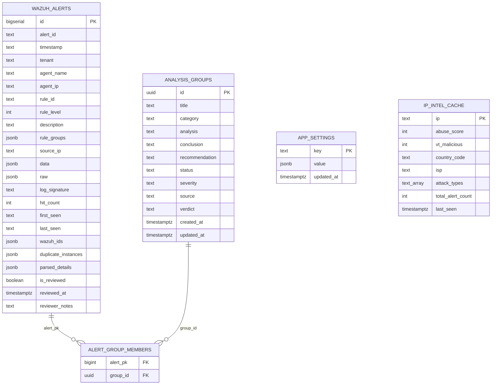

### 6.2 Penyimpanan JSONB

`parsed_details` menyimpan metadata turunan, termasuk
`parsed_details.wazuh_intel` (verdict, role, priority, confidence, signals,
origin, origin_verdict). Ini membuat evolusi klasifikasi tidak memerlukan
migrasi kolom.

Keuntungan: fleksibel dan cepat untuk baseline.
Konsekuensi: query analitik atas field turunan memerlukan indeks ekspresi
(contoh `parsed_details->>'status'`) atau ekstraksi kolom di masa depan.

### 6.3 Indeks

Indeks utama mencakup `source_ip`, `rule_id`, `timestamp`, `tenant`,
`(tenant, log_signature)`, `is_reviewed`, `(tenant, timestamp)`, `rule_level`,
`agent_name`, dan `parsed_details->>'status'`. Dimensi berkardinalitas tinggi
seperti user agent dan URL sengaja tidak diindeks luas untuk mencegah bloat.

### 6.4 Kepemilikan data

| Data | Lokasi | Sifat |
|---|---|---|
| Alert & bukti mentah | `wazuh.alerts` | Sensitif, lokal |
| Kasus & narasi | `wazuh.analysis_groups` | Sensitif, lokal |
| Relasi bukti | `wazuh.alert_group_members` | Lokal |
| Pengaturan & pengguna | `wazuh.app_settings` | Sebagian terenkripsi |
| Cache reputasi | `public.ip_intel_cache` | Lokal / remote read-only |
| Kunci enkripsi | File `0600` di luar repo | Paling sensitif |

---

## 7. Arsitektur Keamanan

### 7.1 Trust boundary

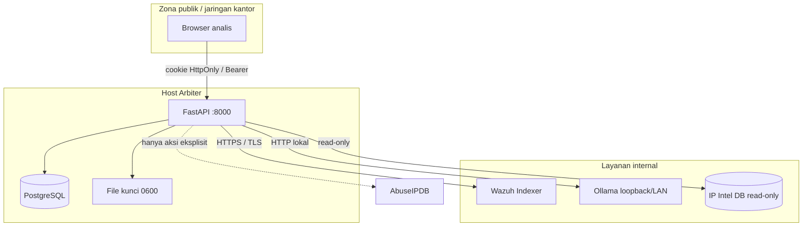

### 7.2 Kontrol keamanan per lapisan

| Lapisan | Kontrol |
|---|---|
| Transport | HTTP lokal; TLS via reverse proxy `docker/nginx/default.conf` |
| Autentikasi | PBKDF2-HMAC-SHA256 120k + sesi Fernet 12 jam |
| Otorisasi | Role `admin` / `analyst`; endpoint admin dicek di middleware |
| Rahasia | Fernet at-rest; kunci dari env/file `0600` di luar repo |
| Input | Validasi tenant, limit, ID grup, pola indeks, URL Ollama |
| SSRF | Ollama hanya loopback/privat/LAN; URL Wazuh diisi operator |
| Data | `safe_alerts()` membuang field mentah sebelum model |
| Ekspor | Scope konsisten + batas 10.000 + `413` eksplisit |
| Destruktif | Preview token 60 detik + kecocokan kriteria + profil read-only |
| Frontend | `esc()` pada semua interpolasi; fetch same-origin; tanpa CDN |
| Privasi | Redaksi deterministik; tanpa klaim "aman" |

### 7.3 Batas yang harus dijaga saat deployment

- Jangan ekspos `PORT=0` (middleware tidak menegakkan auth).
- Ganti password admin awal dan password PostgreSQL default.
- Tempatkan di belakang TLS jika diakses dari jaringan bersama.
- Batasi akses jaringan ke port 8000 dan PostgreSQL.
- `network_mode: host` menghilangkan isolasi jaringan container.
- Profil database disimpan per proses; hindari banyak worker Uvicorn.
- Tenant bukan kontrol otorisasi; jangan jadikan batas keamanan antar tim.

---

## 8. Deployment

### 8.1 Topologi A — Docker standalone

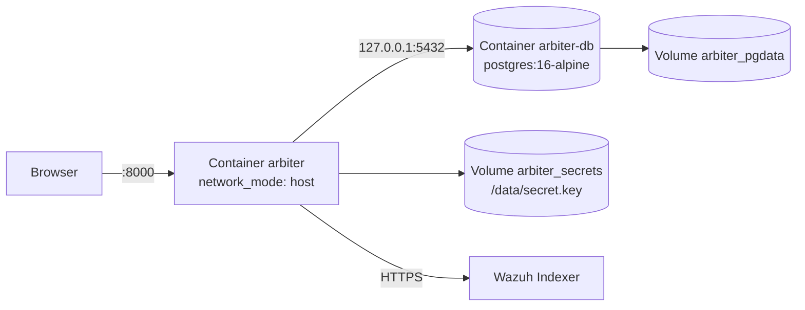

Perintah: `docker compose --profile standalone up -d --build`.

Prasyarat: port 5432 tidak dipakai PostgreSQL host; `DATABASE_URL` harus
menunjuk `arbiter@127.0.0.1:5432/arbiter`.

### 8.2 Topologi B — Host mode

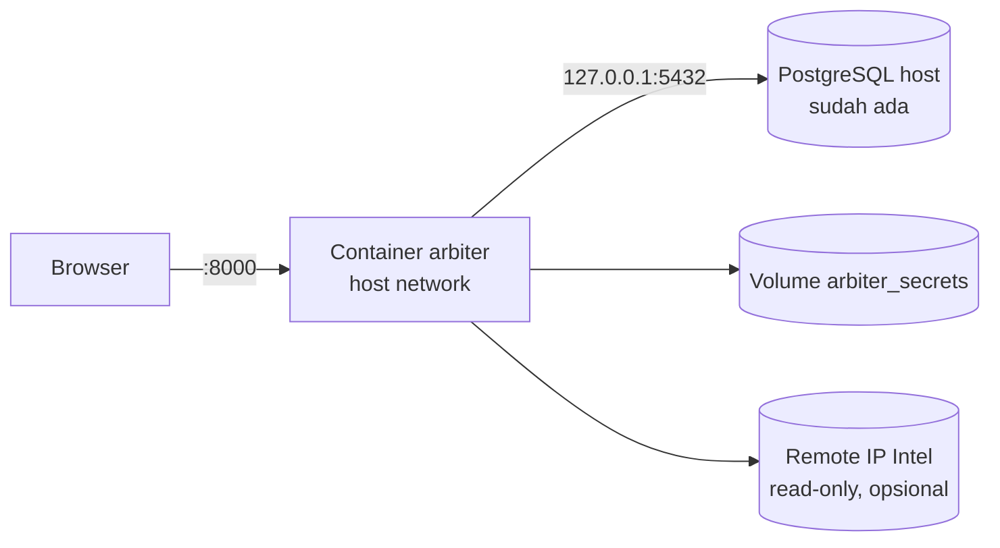

Perintah: `docker compose up -d --build`.

### 8.3 Topologi C — Python lokal

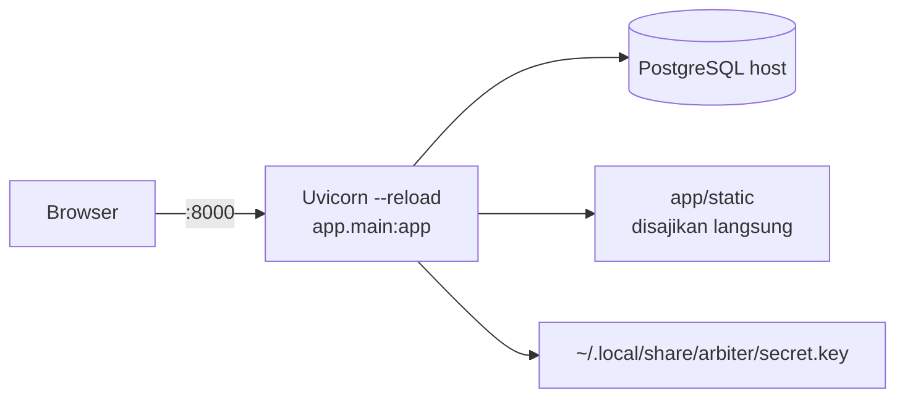

Perintah: `python -m venv .venv`, `pip install -r requirements.txt`,
`./start.sh`.

### 8.4 Topologi D — Reverse proxy TLS

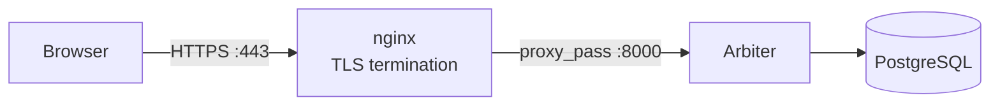

Template tersedia di `docker/nginx/default.conf`. Cookie sesi saat ini tidak
memasang atribut `Secure`; jika memakai HTTPS, pertimbangkan penyesuaian di
reverse proxy/aplikasi.

### 8.5 Startup sequence

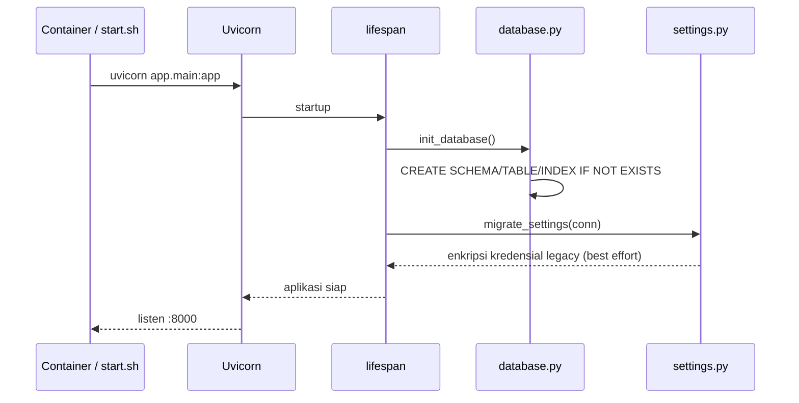

Startup tidak gagal jika migrasi legacy gagal; workspace tetap dapat dibuka.

---

## 9. Alur Realtime

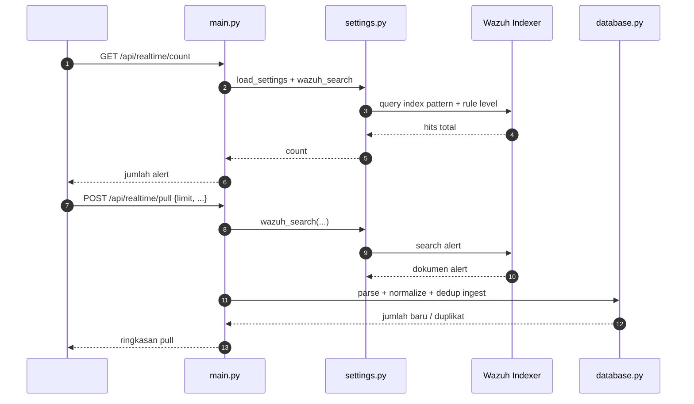

Realtime tidak memakai daemon terpisah; penjadwalan bersifat pull dari UI/API
sesuai interval pengaturan.

---

## 10. Failure Modes dan Degradasi

| Komponen gagal | Perilaku arsitektur |
|---|---|
| PostgreSQL mati | `503` dengan nama profil; UI menampilkan error, bukan data palsu |
| Wazuh Indexer tidak terjangkau | Impor manual tetap bekerja; realtime menampilkan error |
| Ollama mati | AI Triage memakai `local_rules` / `local_rules_fallback` |
| Remote IP Intel mati | Intel kosong ditampilkan "Belum ada cache"; triage tetap jalan |
| Kunci enkripsi hilang | Kredensial tersimpan tidak dapat didekripsi; isi ulang |
| Respons detail usang | Version guard frontend membuang respons lama |
| Export > 10.000 | `413` eksplisit; tidak ada file parsial |
| Dynamic import gagal | Retry sekali dengan URL baru |
| Navigasi dengan perubahan | Guard meminta konfirmasi sebelum meninggalkan halaman |
| Database switch saat purge | `409`; operasi dibatalkan |

---

## 11. Keputusan Arsitektur dan Trade-off

| Keputusan | Alasan | Trade-off |
|---|---|---|
| Modular monolith | Sederhana, mudah di-deploy airgapped, tanpa infrastruktur tambahan | `main.py` besar; batas modul tidak dipaksakan compiler |
| Vanilla JS + hash router | Tanpa build step, cocok untuk lingkungan tertutup | Tidak ada reaktivitas framework; state dikelola manual |
| SQL eksplisit tanpa ORM | Kontrol penuh atas filter tenant/facet dan performa | Duplikasi SQL dan risiko injection harus dijaga manual |
| JSONB `parsed_details` | Evolusi klasifikasi tanpa migrasi | Query turunan perlu indeks ekspresi |
| Rule deterministik + AI opsional | Auditabilitas dan ketersediaan | AI bukan sumber kebenaran; hasil bisa konservatif |
| Profil DB di memori proses | Switching cepat tanpa restart | Tidak aman untuk multi-worker |
| `network_mode: host` | Mudah terhubung ke PostgreSQL/Wazuh host | Isolasi jaringan container hilang |
| Tenant sebagai konteks | Fleksibel untuk analis lintas tenant | Bukan kontrol otorisasi |
| Ekspor sinkron | Implementasi sederhana dan konsisten | Request panjang untuk data besar; batas 10.000 |

---

## 12. Batas Skalabilitas

- **Ingest:** satu request memproses seluruh file secara berurutan; file sangat
  besar memperpanjang response. Belum ada streaming/queue.
- **Triage:** list default 500, maksimum 10.000; korelasi maksimum 300 alert
  terbaru.
- **AI:** maksimum 5.000 alert per permintaan; model lokal menentukan latency.
- **Ekspor:** 10.000 alert per file.
- **Database:** query difilter tenant dan diindeks; volume sangat besar
  sebaiknya dipartisi per waktu di PostgreSQL.
- **Multi-worker:** hindari selama profil database masih global per proses.
- **Frontend:** seluruh HTML dirender di klien; halaman dengan ribuan baris
  membutuhkan pagination (sudah diterapkan).

---

## 13. Peta Direktori Arsitektural

```text
app/
├── main.py                  # API + middleware + orkestrasi
├── parser.py                # Ekstraksi log
├── core.py                  # Normalisasi + dedup signature + grouping
├── wazuh_intel.py           # Klasifikasi + korelasi + chain
├── ai_triage.py             # AI/heuristik + window WIB
├── query.py                 # Filter SQL + facet + spotter
├── database.py              # Skema + koneksi + profil + purge
├── settings.py              # Konfigurasi Wazuh/AI/intel
├── secure_store.py          # Fernet
├── auth.py                  # Pengguna + sesi + role
├── intel.py                 # Reputasi IP
├── privacy.py               # Redaksi
├── exports.py               # Deliverable
├── index.html               # Shell
└── static/
    ├── fonts/               # IBM Plex lokal
    ├── styles/              # tokens · themes · base · shell · components · ledger
    └── js/
        ├── app.js           # Bootstrap + auth gate + tenant
        ├── router.js        # Hash router
        ├── feature-loader.js
        ├── api/client.js
        ├── ui/primitives.js
        ├── state/           # scope · selection · navigation · triage · sidebar · workspace
        └── features/        # 11 modul destinasi
```

---

## 14. Cara Memverifikasi Arsitektur

```bash
# 1. Kontrak API interaktif (saat aplikasi berjalan)
open http://127.0.0.1:8000/docs

# 2. Health
curl -s http://127.0.0.1:8000/health

# 3. Uji domain tanpa database produksi
.venv/bin/python -m unittest \
  tests.test_wazuh_intel tests.test_ai_triage tests.test_parser \
  tests.test_exports tests.test_privacy tests.test_dedup \
  tests.test_ui_api tests.test_ui_safety tests.test_settings \
  tests.test_stats tests.test_triage_scope tests.test_database_trust -q

# 4. Uji frontend
npm test
```

Pemetaan pengujian ke arsitektur:

| Suite | Lapisan yang diverifikasi |
|---|---|
| `test_parser` | Ekstraksi & signature |
| `test_wazuh_intel` | Klasifikasi, korelasi, chain |
| `test_ai_triage` | Clustering, sanitasi payload, window |
| `test_dedup` | Upsert & hit count |
| `test_ui_api` | Scope tenant & detail guard |
| `test_ui_safety` | Tidak ada markup/XSS berbahaya |
| `test_privacy` | Tidak ada kebocoran telemetri |
| `test_settings` | Validasi endpoint & kredensial |
| `test_database_trust` | Profil, purge, preview token |
| `tests/frontend/*` | Router, state, selection, render |

---

## 15. Ringkasan Arsitektur

```text
┌──────────────────────────── Browser ────────────────────────────┐
│ index.html → app.js → router.js → feature/<page>/view.js        │
│        state/ (scope, selection, navigation, triage)            │
│        ui/primitives.js + api/client.js (same-origin fetch)     │
└───────────────────────────────┬─────────────────────────────────┘
                                │ JSON / file / cookie sesi
┌───────────────────────────────▼─────────────────────────────────┐
│ FastAPI :8000                                                   │
│ middleware auth/RBAC → main.py (API) → domain tools             │
│ parser → core → wazuh_intel → ai_triage → query/intel/privacy   │
│ infrastructure: database · settings · secure_store · auth       │
│ exports: HTML · DOCX · XLSX · TSV · Markdown · CSV              │
└───────────────┬───────────────────────────────┬─────────────────┘
                │                               │
        PostgreSQL 16                    Layanan lokal opsional
   wazuh.alerts / analysis_groups         Wazuh Indexer
   alert_group_members / app_settings     Ollama loopback/LAN
   ip_intel_cache                         IP Intel remote (RO)
```

Inti arsitekturnya: **frontend modular tanpa build step, backend monolit modular
dengan tool deterministik, PostgreSQL sebagai sumber kebenaran, dan semua
integrasi eksternal bersifat opsional serta terbatas pada jaringan lokal.**
